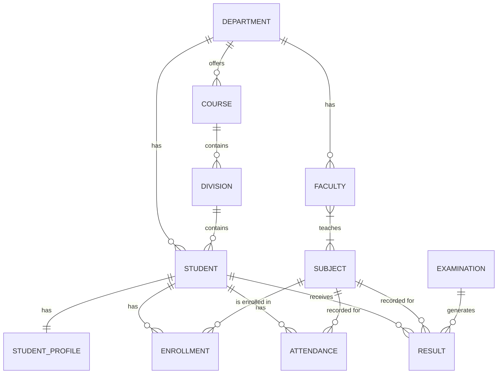

# College ERP — Entity Relationship Diagram (ERD) & Field Design

This document finalizes the database schema design, including fields, data types, primary keys (PK), and foreign keys (FK).

## 1. ERD (Mermaid Diagram)

## 2. Field-Level Design

### 2.1 Department
- `id` (PK, Long)
- `department_code` (String, Unique)
- `department_name` (String)
- `description` (String)

### 2.2 Course
- `id` (PK, Long)
- `department_id` (FK -> Department.id, Many-to-One)
- `course_code` (String, Unique)
- `course_name` (String)
- `degree` (String)
- `duration_years` (Integer)

### 2.3 Division
- `id` (PK, Long)
- `course_id` (FK -> Course.id, Many-to-One)
- `division_name` (String)
- `semester` (Integer)
- `academic_year` (String)

### 2.4 Student
- `id` (PK, Long)
- `department_id` (FK -> Department.id, Many-to-One)
- `division_id` (FK -> Division.id, Many-to-One)
- `roll_number` (String, Unique)
- `first_name` (String)
- `last_name` (String)
- `email` (String, Unique)
- `admission_date` (Date)
- `status` (Enum: ACTIVE, INACTIVE, GRADUATED)

### 2.5 StudentProfile (New for One-to-One mapping)
*Introduced specifically to satisfy the PBL Week 4 One-to-One requirement.*
- `id` (PK, Long)
- `student_id` (FK -> Student.id, One-to-One, Unique)
- `date_of_birth` (Date)
- `phone_number` (String)
- `address` (String)
- `emergency_contact` (String)

### 2.6 Faculty
- `id` (PK, Long)
- `department_id` (FK -> Department.id, Many-to-One)
- `employee_id` (String, Unique)
- `first_name` (String)
- `last_name` (String)
- `email` (String, Unique)
- `designation` (String)

### 2.7 Subject
- `id` (PK, Long)
- `subject_code` (String, Unique)
- `subject_name` (String)
- `credits` (Integer)
- `semester` (Integer)

### 2.8 Faculty_Subject (Join Table for Many-to-Many)
- `faculty_id` (FK -> Faculty.id)
- `subject_id` (FK -> Subject.id)

### 2.9 Enrollment
- `id` (PK, Long)
- `student_id` (FK -> Student.id, Many-to-One)
- `subject_id` (FK -> Subject.id, Many-to-One)
- `academic_year` (String)
- `semester` (Integer)
- `status` (Enum: ENROLLED, COMPLETED, DROPPED)

### 2.10 Attendance
- `id` (PK, Long)
- `student_id` (FK -> Student.id, Many-to-One)
- `subject_id` (FK -> Subject.id, Many-to-One)
- `attendance_date` (Date)
- `status` (Enum: PRESENT, ABSENT)
- `remarks` (String)

### 2.11 Examination
- `id` (PK, Long)
- `exam_name` (String)
- `exam_type` (Enum: INTERNAL, MID_SEM, END_SEM, PRACTICAL)
- `exam_date` (Date)
- `academic_year` (String)

### 2.12 Result
- `id` (PK, Long)
- `student_id` (FK -> Student.id, Many-to-One)
- `subject_id` (FK -> Subject.id, Many-to-One)
- `examination_id` (FK -> Examination.id, Many-to-One)
- `marks` (Double)
- `grade` (String)
- `status` (Enum: PASS, FAIL)
